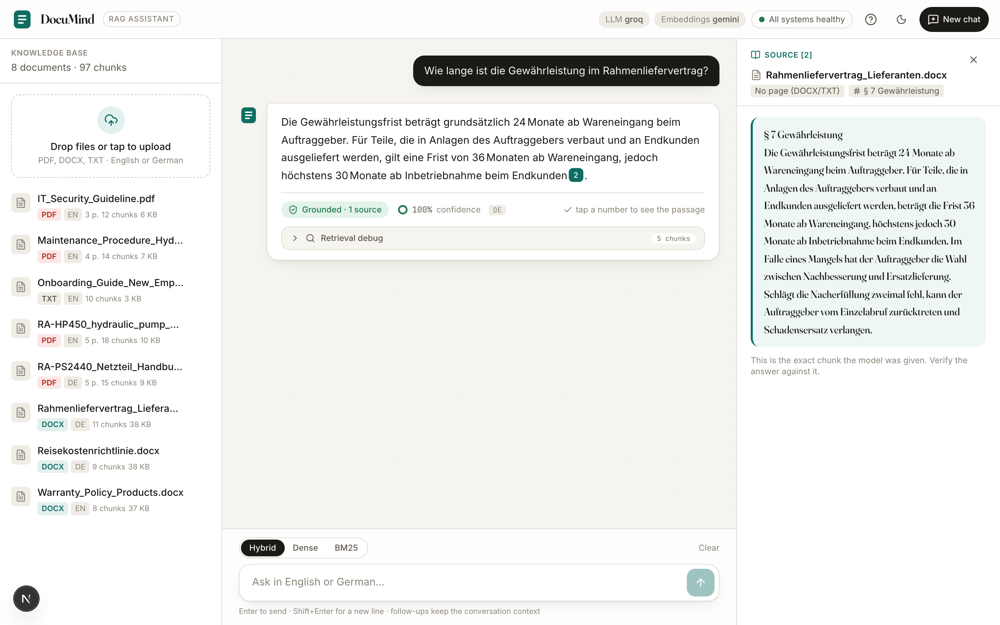
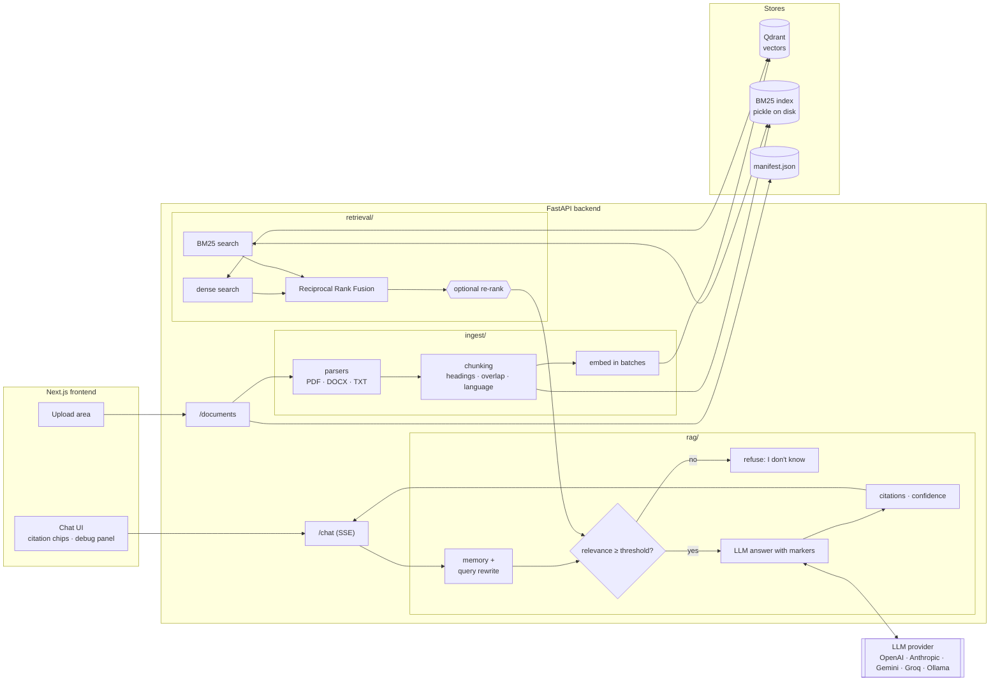
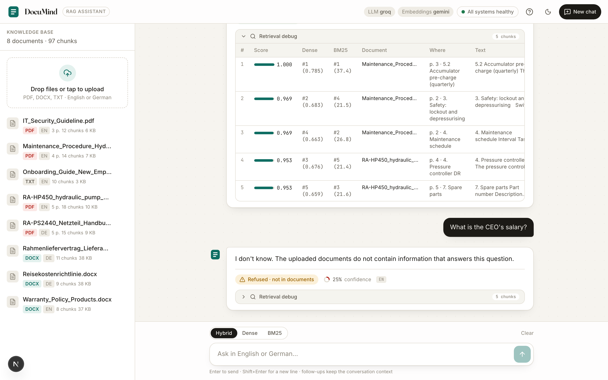

# DocuMind – RAG Knowledge Assistant

**Ask questions about company documents and get answers that cite the exact source passage, or an honest "I don't know".**

[](https://github.com/lakkadumang06/DocuMind-RAG/actions/workflows/ci.yml)




## Why I built it

Industrial companies drown in PDFs: product manuals, supplier contracts, security guidelines,
travel policies. Employees ask the same questions every day ("how long is the warranty?",
"wie hoch ist die Hotel-Obergrenze in München?") and either search for twenty minutes or ask
a colleague. A plain chatbot is not the answer either, because an LLM that confidently invents
a warranty period is worse than no assistant at all.

DocuMind is my answer to that problem and a portfolio project for AI working-student roles:

- **Every answer shows its sources.** Click a citation chip and you see the exact chunk,
  document, page and section the model was given.
- **It refuses when it should.** If retrieval finds nothing relevant, or the model says the
  context does not contain the answer, DocuMind replies "I don't know" instead of guessing.
- **It is measured, not just demoed.** A golden dataset of 35 questions compares dense,
  keyword and hybrid retrieval, two chunk sizes, answer correctness, faithfulness and refusal
  accuracy. See the [eval results](#evaluation-results) below.

## Features

| Area | What it does |
|---|---|
| Ingestion | PDF (with page numbers), DOCX (with heading styles and tables) and TXT. Heading-aware recursive chunking with configurable size and overlap, language detection per chunk, idempotent re-ingestion by content hash. |
| Retrieval | Dense vectors in Qdrant **and** BM25 keyword search, merged with Reciprocal Rank Fusion. Switch between `dense`, `bm25` and `hybrid` per request. Optional LLM re-ranking. |
| Answers | Structured `ChatAnswer`: answer text, list of citations (document, page, section, verbatim quote), confidence, `answer_found`. Answers in the language of the question (English or German). |
| Memory | Per-session conversation history with query rewriting, so "and what about the warranty?" becomes a standalone question. |
| Model layer | `get_llm()` / `get_embeddings()` for OpenAI, Anthropic, Gemini, Groq and local Ollama. Switch with two environment variables. Only `llm.py` imports vendor SDKs. |
| API | FastAPI: `POST /documents` (upload + ingest), `POST /documents/samples` (index the bundled sample files), `GET /documents`, `DELETE /documents/{id}`, `POST /chat` (Server-Sent Events: streamed tokens, then a final event with citations), `GET /health`. |
| UI | Next.js 16 + TypeScript + Tailwind: responsive three-column layout (drawer and bottom sheet on phones), light and dark mode, one-click sample documents and a "How it works" guide for new users, drag-and-drop upload with progress, streamed chat, clickable citation chips, retrieval mode toggle, collapsible retrieval debug panel with scores. |
| Quality | 61 pytest tests that run **without API keys** (in-memory Qdrant, fake embeddings, fake LLM), ruff, GitHub Actions CI for backend, frontend and Docker images. |

## Architecture



One question flows through five steps: rewrite (only with history), retrieve (dense + BM25,
fused), threshold (refuse early if nothing is relevant), generate (the model must cite every
claim as `[n]` or reply `NO_ANSWER`), structure (markers are mapped back to chunks, the
confidence is blended with retrieval relevance, and the final SSE event carries the
`ChatAnswer`). Details and the reasoning behind each piece are in
[docs/architecture.md](docs/architecture.md).



## Quickstart

Prerequisites: Python 3.12, Node 20+, Docker and a free Google API key from
[aistudio.google.com/apikey](https://aistudio.google.com/apikey). By default DocuMind uses
hosted Gemini models: `gemini-3.5-flash` for answers and `gemini-embedding-001` for vectors.

```bash
git clone https://github.com/lakkadumang06/DocuMind-RAG.git
cd DocuMind-RAG
cp .env.example .env          # then set GOOGLE_API_KEY=your_key_here

make install                  # backend venv + frontend packages
make sample-docs              # generate 8 fictional documents (EN + DE) into data/sample_docs
make qdrant                   # start Qdrant in Docker
make ingest                   # parse, chunk, embed, index -> prints chunks per document
make ask Q="Wie lange ist die Gewährleistung?"   # try it from the terminal

make api                      # terminal 1: http://localhost:8000/docs
make web                      # terminal 2: http://localhost:3000
```

New to the project? Open http://localhost:3000, click **Load sample documents** and then one
of the example questions. The **?** button in the header explains the flow and lists things
to try (German questions, a refusal, a follow-up, switching retrieval modes).

Without `make`, the same steps are:

```bash
docker compose up -d qdrant
cd backend && python3.12 -m venv .venv && .venv/bin/pip install -e ".[dev]"
.venv/bin/python -m app.ingest.pipeline ../data/sample_docs
.venv/bin/uvicorn app.api:app --reload --port 8000        # backend
# second terminal, from the repo root:
cd frontend && npm install && npm run dev                 # frontend
```

Or run everything in containers:

```bash
docker compose up --build     # qdrant :6333, api :8000, web :3000
```

### Choosing models

Switch providers with `LLM_PROVIDER` and `EMBEDDING_PROVIDER` in `.env`.

| `LLM_PROVIDER` | `EMBEDDING_PROVIDER` | Needs | Notes |
|---|---|---|---|
| `gemini` (default) | `gemini` (default) | `GOOGLE_API_KEY` | One key for both answers and embeddings. |
| `openai` | `openai` | `OPENAI_API_KEY` | Simplest alternative hosted setup. |
| `groq` | `gemini` or `openai` | `GROQ_API_KEY` | Very fast answers. Groq has no embedding models. |
| `anthropic` | `gemini` or `openai` | `ANTHROPIC_API_KEY` | Anthropic has no embedding models. |
| `ollama` | `ollama` | [Ollama](https://ollama.com) with `qwen3:8b` and `nomic-embed-text` | Fully local: no document leaves the machine, but slower. |

Changing the embedding model changes the vector size (gemini-embedding-001 has 3072
dimensions, nomic-embed-text 768). Use a new `QDRANT_COLLECTION` name or delete the old
collection, then re-ingest with `--force`.

The sample documents belong to the fictional **Rheintal Antriebstechnik GmbH**: two product
manuals (hydraulic pump, power supply), a German supplier framework contract, a warranty
policy, an IT security guideline, a German travel expense policy, an onboarding guide and a
maintenance procedure. They contain numbered sections and tables on purpose, so that chunking
and page-level citations actually matter.

## Deploy on Render

`render.yaml` describes two free Docker web services (`documind-api`, `documind-web`). Qdrant
is not hosted on Render; use the free tier of [Qdrant Cloud](https://cloud.qdrant.io).

1. Create a Qdrant Cloud cluster and copy its URL and API key.
2. Render dashboard -> **New** -> **Blueprint** -> select this repository. Render reads
   `render.yaml` and asks for the secret values: `GOOGLE_API_KEY` (or `GROQ_API_KEY`),
   `QDRANT_URL`, `QDRANT_API_KEY`.
3. If you rename the services, update `CORS_ORIGINS` on the API and `NEXT_PUBLIC_API_URL`
   on the web service to match the new `*.onrender.com` hostnames and redeploy the web
   service (the URL is baked in at build time).
4. Open the web URL and click **Load sample documents**.

Free-tier notes: services sleep after 15 minutes without traffic, so the first request takes
about a minute; the disk is ephemeral, so uploads and the BM25 index are lost on every deploy
or restart (re-load the samples, or attach a Render Disk at `/app/data` on a paid plan).

## Evaluation results

Measured on 2026-11-10 with a fully local setup (qwen3:8b for answers and as judge,
nomic-embed-text embeddings, both via Ollama on a MacBook), before the default switched to
Gemini. The local run is the worst case: a small 8B model on a laptop. Full report with every failure:
[backend/evals/results.md](backend/evals/results.md). Reproduce with `make evals`.

**Retrieval** (30 answerable questions, top 5):

| Chunk size | Mode | Hit rate@5 | MRR | Misses |
|---|---|---|---|---|
| 500 | hybrid | 93 % | 0.773 | q06, q11 |
| 500 | dense | 87 % | 0.756 | q06, q07, q09, q16 |
| 500 | bm25 | 93 % | 0.797 | q06, q12 |
| 800 | hybrid | 90 % | 0.750 | q06, q07, q11 |
| 800 | dense | 83 % | 0.704 | q06, q07, q09, q11, q16 |
| 800 | bm25 | 93 % | 0.819 | q06, q12 |
| 1000 | hybrid | 90 % | 0.764 | q06, q07, q11 |
| 1000 | dense | 83 % | 0.721 | q06, q07, q09, q11, q16 |
| 1000 | bm25 | 93 % | 0.819 | q06, q12 |

**Answers** (chunk size 800, 30 answerable + 5 unanswerable questions):

| Mode | Answered | Correct | Mean score | Faithful | Refusal acc. | Latency mean | Latency p95 | Est. cost |
|---|---|---|---|---|---|---|---|---|
| hybrid | 100 % | 83 % | 85 % | 90 % | 80 % | 4.0 s | 5.8 s | $0.0000 |
| dense | 100 % | 83 % | 85 % | 87 % | 80 % | 3.6 s | 5.2 s | $0.0000 |
| bm25 | 97 % | 87 % | 87 % | 97 % | 80 % | 3.5 s | 5.4 s | $0.0000 |

What the numbers say:

- **BM25 is hard to beat on this corpus.** Manuals and contracts are full of exact
  identifiers (`RA-HP 450`, `ISO 4406`, `§ 7`, `DC OK`) that keyword search nails, and the
  corpus is small (97 chunks). Hybrid search still wins the cases where wording differs
  (q12, the contract term question) and is the safer default for larger, more varied corpora.
- **Cross-language questions are the weak spot.** The misses q06 and q07 are German
  questions about English PDFs (and vice versa) with a small embedding model. A multilingual
  embedding model (for example `bge-m3`) is the first thing to try.
- **Chunk size matters less than expected** between 500 and 1000 characters because chunks
  never cross a section heading anyway; 500 gives the best hit rate for hybrid.
- **Refusal accuracy 80 %** means one of the five trap questions was answered. The 8B local
  model also sometimes writes "the passages do not mention X" in prose instead of the
  `NO_ANSWER` token, which counts as a wrong answer; a stronger model or a second check
  for such phrases would fix this.
- **Cost is $0** locally. With the Gemini defaults, `make evals` re-measures everything and
  estimates the cost from the price table.

How the metrics are computed:

- **Hit rate@5 / MRR**: is a chunk from the expected document *and* page (PDF) or section
  (DOCX/TXT) among the top 5, and at which rank.
- **Correct**: an LLM judge scores the answer 0 to 2 against the reference answer with a
  rubric; "correct" means 2 of 2.
- **Faithful**: a second judge call checks that every claim in the answer is supported by the
  chunks the answer cited.
- **Refusal accuracy**: share of the 5 unanswerable questions that were refused.
- **Cost**: approximate, from a 4-characters-per-token estimate and the price table in
  `backend/app/llm.py`.

## Design decisions

**Why hybrid search.** Embeddings understand paraphrases and cross-language questions (an
English question about a German contract), but they are weak on exact identifiers such as
`RA-HP 450`, `ISO 4406` or `§ 7`. BM25 is the opposite. Reciprocal Rank Fusion merges both
lists without having to calibrate scores from two different systems: each list contributes
`1 / (60 + rank)` and the sums are ranked. The debug panel in the UI shows both ranks so you
can see which retriever found what.

**Why citations and refusal.** In an industrial setting a wrong torque value or warranty period
has real consequences. The model only sees numbered passages and must cite them; the backend
maps the markers back to chunks, so a citation can never point to text the model did not see.
Before the model is called at all, the top fused relevance score is compared to a threshold;
below it, the API refuses without spending an LLM call. The model can also refuse itself with
`NO_ANSWER`.

**Chunking trade-offs.** Chunks never cross a section heading or a PDF page, so citations stay
precise, and the nearest heading is prepended to every chunk so that a table row like
`14 Tage | 3 % Skonto` still carries "§ 4 Preise und Zahlungsbedingungen" as context. Smaller
chunks give more precise citations and better keyword matching; larger chunks keep more
context for the model. The eval compares 500, 800 and 1000 characters.

**Local Ollama vs hosted models.** Ollama keeps every document on the machine, which matters
for contracts and drawings, but a laptop generates a few tokens per second and small models
follow citation rules less reliably. Hosted models are faster, cheaper per request and better
at structured output, but send chunk text to a third party. DocuMind makes the switch a
two-variable change so the decision can be made per deployment, not per codebase.

**Citation markers instead of JSON tool calls.** The model streams plain text with `[n]`
markers and a final `CONFIDENCE:` line. That keeps one code path for streaming and
non-streaming answers and works with small local models that have no tool-calling support.

## Project layout

```
backend/app/
  config.py        settings from .env (pydantic-settings)
  llm.py           get_llm / get_embeddings for 5 providers + price table
  schemas.py       Pydantic models (Chunk, Citation, ChatAnswer, ...)
  ingest/          parsers, chunking, BM25 index, Qdrant store, pipeline (+ CLI)
  retrieval/       dense, bm25, hybrid (RRF), optional re-ranker
  rag/             prompts, conversation memory, answer pipeline (+ CLI)
  api.py           FastAPI routes and SSE streaming
backend/tests/     pytest suite with fakes, no network
backend/evals/     dataset.json, run_evals.py, results.md
frontend/          Next.js App Router UI
scripts/           make_sample_docs.py
data/sample_docs/  the 8 generated documents
docs/              architecture.md, screenshots
```

## Limitations

- Conversation memory lives in the API process. Several API replicas would need Redis.
- The BM25 index is a pickle that is rebuilt on every change; fine for thousands of chunks,
  not for millions.
- Tables in PDFs are read as text lines; merged cells or multi-column layouts can scramble.
- DOCX and TXT have no page numbers, so citations use the section heading instead.
- The LLM judge in the evals is itself a model and can be wrong; the results file lists every
  failure so they can be checked by hand.
- No authentication. The API is meant to run inside a company network or behind a gateway.

## Roadmap

- Cross-encoder re-ranking (bge-reranker) as a faster alternative to the LLM re-ranker
- Qdrant sparse vectors instead of the on-disk BM25 pickle
- Document-level access control and an audit log of questions and cited sources
- Table-aware PDF parsing
- Evaluation in CI against a hosted model on every pull request

## Author

**Umang Lakkad** – [linkedin.com/in/umang-lakkad-923212299](https://www.linkedin.com/in/umang-lakkad-923212299) · [github.com/lakkadumang06](https://github.com/lakkadumang06)

MIT License, see [LICENSE](LICENSE).
