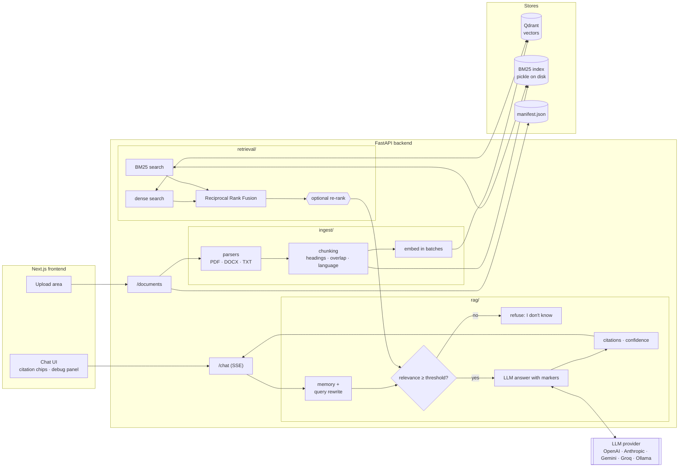

# DocuMind architecture

DocuMind is a retrieval-augmented generation (RAG) system: documents are split into
chunks and indexed twice (dense vectors in Qdrant, keyword index with BM25). A question
is run against both indexes, the results are fused, and an LLM writes an answer that
cites the chunks it used. If retrieval finds nothing relevant, or the model says the
context does not answer the question, the system refuses instead of guessing.



## Request flow for one question

1. **Rewrite** – if the session has history, the LLM rewrites "and the warranty?" into a
   standalone question. Without history this step costs nothing.
2. **Retrieve** – the query is embedded and searched in Qdrant (cosine), and tokenised
   and searched in BM25. Each list contributes `1 / (60 + rank)` per chunk; the sums are
   normalised so a chunk ranked first in both lists scores 1.0.
3. **Threshold** – the top fused score is compared with `MIN_RELEVANCE_SCORE`. Below it
   the API returns a refusal in the question's language without calling the LLM.
4. **Generate** – the model receives the numbered passages and must cite each claim with
   `[n]`, answer in the user's language, or reply `NO_ANSWER`. It ends with a
   `CONFIDENCE: x` line.
5. **Structure** – tokens are streamed to the browser as they arrive. At the end the
   markers are mapped back to chunks to build `Citation` objects, the confidence line is
   stripped and blended with retrieval relevance, and a final SSE event carries the
   `ChatAnswer` (answer, citations, confidence, answer_found, retrieved chunks).

## Why these choices

| Decision | Reason |
|---|---|
| Hybrid retrieval | Embeddings handle paraphrases and cross-language questions; BM25 handles exact identifiers such as `RA-HP 450`, `ISO 4406` or `§ 7`. RRF merges them without score calibration. |
| Chunk by headings, then size | Numbered sections and tables in manuals and contracts are natural units. The nearest heading is prepended to every chunk so a table row still carries its context. |
| Citation markers instead of JSON | One code path for streaming and non-streaming, and it works with small local models that have no tool-calling support. |
| Refuse on low relevance | A wrong answer with a confident tone is worse than no answer in an industrial setting. The threshold is cheap and explainable. |
| Provider-agnostic `llm.py` | Only one file imports vendor SDKs. Local Ollama keeps data on-premise; hosted models are faster and cheaper per request. |
| BM25 in a pickle, manifest in JSON | Simple, inspectable and enough for thousands of chunks. Both sit behind small classes so they can be swapped for OpenSearch or a database. |

## Code map

```
backend/app/
  config.py        pydantic-settings, the only place that reads the environment
  llm.py           get_llm() / get_embeddings() for 5 providers, price table
  schemas.py       Pydantic models shared by all layers and the API
  ingest/          parsers.py, chunking.py, bm25_index.py, store.py (Qdrant), pipeline.py
  retrieval/       vector.py, bm25.py, hybrid.py (RRF), rerank.py (optional)
  rag/             prompts.py, memory.py, answer.py (RagAnswerer + CLI)
  api.py           FastAPI routes, SSE streaming, AppState wiring
backend/evals/     dataset.json, run_evals.py, results.md
frontend/          Next.js App Router UI
```
